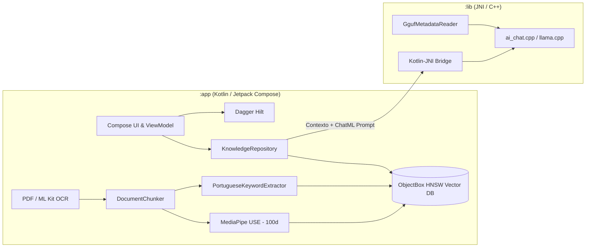

# Offline Edge AI Assistant (Local LLM + Hybrid RAG on Android)

Assistente inteligente 100% offline para dispositivos Android, projetado para executar **Small Language Models (SLMs)** localmente com baixa latência, privacidade total de dados e recuperação aumentada por geração (**RAG híbrido**) sobre documentos do usuário.

## Arquitetura do Sistema

O projeto adota uma estrutura modular separando a camada de aplicação/RAG (`:app`) do motor de inferência nativo (`:lib`):

## Destaques de Engenharia

* **Inferência Nativa sem Nuvem:** Integração entre Kotlin e C++ (`llama.cpp`) via JNI/NDK com leitura dinâmica de metadados de arquivos `.gguf` no módulo `:lib`.
* **Gerenciamento Adaptativo de Memória (Hardware-Aware):** Detecção automática da RAM total do dispositivo para ajustar dinamicamente a janela de contexto (`context size`) e desativar backends propensos a *Out-Of-Memory* (OOM) em dispositivos móveis.
* **Pipeline RAG Híbrido Local:**
  * **Ingestão:** Extração nativa de texto de PDFs combinada com OCR on-device (**Google ML Kit**) para documentos digitalizados.
  * **Indexação Vetorial:** Geração de embeddings de 100 dimensões com **MediaPipe Universal Sentence Encoder** (`TFLite`) armazenados em índice **HNSW no ObjectBox**.
  * **Busca Combinada:** Fusão de similaridade semântica com extração de palavras-chave em português (`PortugueseKeywordExtractor`) para maior precisão nas respostas.
* **Arquitetura Moderna Android:** Interface reativa em **Jetpack Compose**, padrão **MVVM + Repository** e injeção de dependências com **Dagger Hilt**.

## Stack Tecnológica

| Camada | Tecnologias |
| :--- | :--- |
| **Linguagens** | Kotlin, C++ (NDK / CMake) |
| **Motor de IA & Embeddings** | `llama.cpp` (GGUF), MediaPipe (`universal_sentence_encoder.tflite`), Google ML Kit OCR |
| **Banco Vetorial & Dados** | ObjectBox (HNSW Vector Search) |
| **UI & Arquitetura** | Jetpack Compose, MVVM, Coroutines, Dagger Hilt |

## Como Executar

1. Clone este repositório e abra no **Android Studio** (com NDK e CMake instalados via SDK Manager).
2. Baixe um modelo compatível no formato `.gguf` quantizado (ex.: Qwen2.5 ou Llama-3.2 em `Q4_K_M`) diretamente no armazenamento do dispositivo Android.
3. Compile e execute o módulo `:app` em um dispositivo físico (recomendado 6 GB+ de RAM) e selecione o arquivo `.gguf` na tela inicial do aplicativo.

## Créditos e Licença

O módulo nativo `:lib` utiliza como base a camada de integração JNI/C++ para `llama.cpp` inspirada nos exemplos open-source da Arm (`com.arm.aichat`), estendida neste projeto com controle dinâmico de contexto por hardware, arquitetura Compose/Hilt e pipeline completo de RAG híbrido on-device. Distribuído sob licença **Apache 2.0**.
